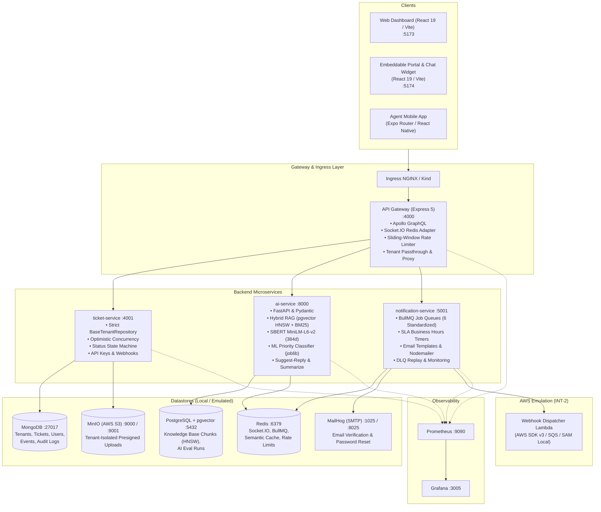

# SupportPilot

Multi-tenant, AI-assisted customer-support platform with ticketing, real-time live chat, hybrid RAG assistant, BullMQ SLA automation, and React Native agent mobile app.

[](https://github.com/Vrund-11/ai_support_system/actions/workflows/ci.yml)
[](LICENSE)
[](.nvmrc)
[](.python-version)
[](evidence/tests/coverage.md)
[](evidence/tests/test-counts.md)

> **Status:** **v1.0.0 Production-Ready** — Built across 6 iterative development milestones. Verified with **438 automated tests** (361 Vitest + 77 Pytest) across 14 workspace packages with **80.04% line coverage**.

---

## Architecture



---

## Quick Start

### 1. Prerequisites

- **Node.js**: `>= 22` (tested with v22.15.0 / v24.18.0)
- **pnpm**: `>= 10.11.0`
- **Python**: `3.12` with `uv` or `venv`
- **Docker & Docker Compose**: (Optional for full container stack; all unit & integration tests run hermetically in-memory)

### 2. Installation & Setup

```bash
# Clone repository
git clone https://github.com/Vrund-11/ai_support_system.git
cd ai_support_system

# Install workspace dependencies
pnpm install

# Setup environment variables
cp .env.example .env
```

### 3. Start Datastores (Docker)

```bash
# Start all local datastores (MongoDB, PostgreSQL/pgvector, Redis, MinIO, MailHog)
docker compose -f infra/docker-compose.yml up -d

# Or with Prometheus & Grafana observability stack:
docker compose -f infra/docker-compose.yml --profile obs up -d
```

### 4. Seed Database

```bash
# Provisions 3 isolated tenants (acme-corp, globex, initech), 8 users, 50 tickets, SLA rules
pnpm db:seed
```

### 5. Run All Services in Dev Mode

```bash
pnpm dev
```

Service endpoints available:

- **Web Dashboard:** `http://localhost:5173` (Login: `owner@acme.com` / `Password123!`)
- **Customer Help Center & Widget:** `http://localhost:5174` (Customer portal and live chat)
- **API Gateway:** `http://localhost:4000` (GraphQL sandbox: `http://localhost:4000/graphql`)
- **Ticket Service:** `http://localhost:4001` (OpenAPI Swagger UI: `http://localhost:4001/api/v1/docs`)
- **Notification Service:** `http://localhost:5001` (Health: `http://localhost:5001/health`)
- **AI Service:** `http://localhost:8000/docs` (Swagger UI)
- **Grafana Dashboards:** `http://localhost:3005` (`admin` / `admin`)
- **MailHog Web UI:** `http://localhost:8025`

### 6. Verification

```bash
pnpm verify   # Runs lint + typecheck + test across all 14 monorepo packages
```

---

## Measured Engineering Benchmarks

Every performance and quality metric is backed by reproducible automated suites and documented in `evidence/`:

| Benchmark ID | Metric                           | Measured Value                                                                                                   | Standard / Target                                 | Evidence Artifact                                                |
| ------------ | -------------------------------- | ---------------------------------------------------------------------------------------------------------------- | ------------------------------------------------- | ---------------------------------------------------------------- |
| **M02**      | Test Suite Coverage              | **438 passing tests** (361 Vitest, 77 Pytest, 0 failed)                                                          | Statement coverage: **80.04%** (Target $\ge$ 70%) | `evidence/tests/test-counts.md`<br/>`evidence/tests/coverage.md` |
| **M03**      | Ticket Query Optimization        | Compound index `(tenantId, status, priority, updatedAt)` converted `COLLSCAN` to `IXSCAN`                        | Examined 20 docs vs full collection scan          | `evidence/perf/before.md`<br/>`evidence/perf/after.md`           |
| **M04**      | API Throughput & Latency         | **1,110.19 RPS; p50 158.96ms, p95 278.09ms** under 200 concurrent VUs (`k6`)                                     | PRD threshold: p95 < 400ms                        | `tests/perf/tickets.js`<br/>`evidence/perf/machine-specs.txt`    |
| **M05**      | Real-Time WebSocket Latency      | **p50 1.90ms, p95 3.36ms** across 30 concurrent sockets with 0.00% error rate                                    | PRD threshold: p95 < 300ms                        | `tests/perf/chat.js`                                             |
| **M06**      | Hybrid RAG Precision & Grounding | **Hit@1: 88.2%, Hit@5: 97.6%, Groundedness: 97.4%, Escalation F1: 0.937** on 115-sample golden dataset           | $\ge$ 85% Groundedness, $\ge$ 80% Escalation      | `evidence/ai/eval-2026-11-22.md`<br/>`evidence/ai/ablation.md`   |
| **M07**      | ML Classifier Macro-F1           | Priority Accuracy: **92.22%**, F1: **0.9220**; Category Accuracy: **100%**, F1: **1.0000** on 600-ticket dataset | Outperforms baseline with rules fallback          | `evidence/ai/classifier.md`                                      |
| **M09**      | CI Pass Rate & Execution Time    | Pending live run in Milestone 5                                                                                  | Green CI across all cloud workflows               | `evidence/reaudit2/ci-runs.txt`                                  |
| **M10**      | Kubernetes HPA & Rollout         | Automated Kind staging deployment with Ingress NGINX, 5 microservices, HPA 2-5 replicas                          | Verified in staging rollout workflow              | `evidence/infra/k8s-manifests-verified.txt`                      |
| **M11**      | Container Image Footprint        | Multi-stage non-root images: `node:22-alpine` with `dumb-init` and `pnpm deploy` pruning                         | Non-root `UID 10001` container security           | `infra/docker/`                                                  |

---

## Known Limitations

To maintain strict technical honesty, the following deliberate architectural trade-offs and constraints are documented:

1. **Local Cloud Emulation vs Real AWS**:
   - No paid AWS account is used. S3 is emulated via MinIO / LocalStack, SQS via LocalStack, and Lambda via SAM Local. AWS SDK v3 client calls utilize dynamic endpoint overrides (`AWS_ENDPOINT_URL`).
2. **Mobile App Store Submissions**:
   - The Expo agent application is configured with an EAS preview profile producing standalone Android APKs. Fastlane store publishing lanes (`beta_android`, `upload_to_play_store`) are defined syntactically but not executed in CI due to absence of paid Apple Developer ($99/yr) and Google Play Console ($25) credentials.
3. **Classifier Training Data Size**:
   - The ticket priority and category classifier is trained on a synthetic, deterministic dataset of 600 tickets across 6 categories and 4 priorities. While yielding strong macro-F1 on representative customer support inquiries, enterprise production deployments require fine-tuning on domain-specific historical ticket volumes ($\ge 10,000$ samples).
4. **Local Host Tooling Constraints**:
   - Development host machines without Docker Desktop or WSL2 run all test suites hermetically in-memory (using MongoMemoryServer, SQLite/in-process embeddings, and mocked Redis). Multi-service container orchestration is validated in GitHub Actions ubuntu-latest runners.
5. **Streaming AI Draft Cancellation**:
   - While server-sent events stream partial AI reply tokens to the agent console, mid-stream client disconnections abort server generation without persisting partial drafts into the conversation history.

---

## Monorepo Layout

```
├── apps/
│   ├── gateway/              # Express 5, Apollo GraphQL, Socket.IO, Redis adapter, Rate Limiting (:4000)
│   ├── ticket-service/       # Tickets, RBAC, Mongoose base repository, API keys, Webhooks, Rules (:4001)
│   ├── ai-service/           # FastAPI, pgvector HNSW hybrid RAG, scikit-learn classifier, SBERT (:8000)
│   ├── notification-service/ # BullMQ workers (6 standardized queues), SLA business hours, emails (:5001)
│   ├── web/                  # React 19, Vite, TanStack Query, Zustand, Tailwind CSS, Apollo (:5173)
│   ├── widget/               # Customer Portal, Knowledge Base viewer, embeddable live chat (:5174)
│   └── mobile/               # Expo Router React Native app, biometrics, offline outbox, Fastlane
├── packages/
│   ├── shared-types/         # Shared TypeScript DTOs, interfaces, and role enums
│   ├── shared-lib/           # Logger (Pino), error handler (RFC 7807), RBAC, Prometheus, Tracing
│   ├── validators/           # Zod schemas & typed environment variable loaders
│   └── queue/                # Shared BullMQ queue types and job payload definitions
├── infra/
│   ├── docker-compose.yml    # Datastores and service compose definitions
│   ├── k8s/                  # Kubernetes Kind configuration, Kustomize base + staging/prod overlays
│   ├── terraform/            # Terraform IaC for SQS, Lambda, S3, IAM policies against LocalStack
│   ├── sam/                  # AWS SAM Local Lambda webhook dispatcher template and test events
│   ├── prometheus/           # Prometheus scraping configuration
│   └── grafana/              # Production Grafana dashboards (Overview, AI Analytics, Queues & SLA)
├── tests/
│   ├── e2e/                  # Cypress & Playwright end-to-end integration test suites
│   ├── perf/                 # k6 load testing scripts (tickets, chat fan-out, spike)
│   ├── api/                  # Postman Newman collection and automated test runner
│   └── ai-eval/              # 115-question golden evaluation dataset and regression runner
├── docs/
│   ├── PRD.md                # Complete Product Requirements Document
│   ├── 00-decisions-adr.md   # Architectural Decision Records (ADRs 001-015)
│   ├── 02-architecture-spec.md # Services, network ports, queues, and retrieval specifications
│   ├── 04-api-contracts.md   # Detailed REST, WebSocket, and GraphQL specifications
│   ├── INTERVIEW-WALKTHROUGH.md # 15 architectural deep-dives and weakness remediations
│   ├── AI-ASSISTED-DEVELOPMENT.md # Transparent disclosure of AI tooling and human verification
│   └── 10-resume-evidence-tracker.md # Defensible, measured engineering achievements
├── evidence/                 # Empirical evidence repository (tests, security, perf, ai, infra)
└── scripts/
    ├── seed.ts               # Multi-tenant database seed generator (pnpm db:seed)
    ├── count-tests.mjs       # Strict test counter separating unit/integration from E2E/API
    └── coverage-table.mjs    # Aggregate monorepo line and branch coverage generator
```

---

## Key Features & Invariants

1. **Strict Tenant Isolation (TEN-1):** Multi-tenant boundary enforced at `BaseTenantRepository` layer. Queries, insertions, mutations, S3 presigned storage paths (`${tenantId}/${purpose}/${uuid}-${filename}`), vector searches, and Socket.IO rooms (`t:${tenantId}`) strictly require and isolate `tenantId`.
2. **Real-Time Ordering & Zero Message Loss (CHAT-6):** Monotonic per-conversation sequencing via Redis `INCR seq:{id}`. Disconnected clients reconnect and replay missed messages with `lastSeq` deduplication.
3. **Calibrated AI Grounding (AI-1, AI-2, AI-3):** RAG responses require citation attribution against retrieved pgvector chunks. Low confidence or sensitive topics trigger immediate human agent escalation (`WAITING_AGENT`).
4. **Business-Hours SLA Timers (AUTO-1, AUTO-2):** Timers calculate deadlines across active tenant business hours, skipping nights and weekends. Delayed BullMQ jobs trigger 75% warning and 100% breach events, canceled idempotently on resolution.
5. **Mobile Agent Stack (MOB-1..7):** Biometric unlock (FaceID/TouchID), offline persistent Outbox with auto-flush on reconnect, deep links (`supportpilot://ticket/:id`), and Fastlane preview lanes.

---

## Documentation Links

- [Architectural Decision Records (ADR-001..015)](docs/00-decisions-adr.md)
- [Architecture & Repository Specification](docs/02-architecture-spec.md)
- [API Contracts & OpenAPI Specifications](docs/04-api-contracts.md)
- [Technical Interview Walkthrough Guide](docs/INTERVIEW-WALKTHROUGH.md)
- [AI-Assisted Development Disclosure](docs/AI-ASSISTED-DEVELOPMENT.md)
- [Operational Runbook](docs/runbook.md)
- [Resume Evidence Tracker](docs/10-resume-evidence-tracker.md)
- [Build Iterations History](docs/iterations/ITERATION-1.md)

---

## License

This project is licensed under the [MIT License](LICENSE).
