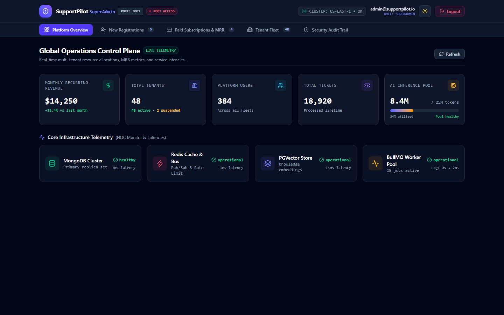
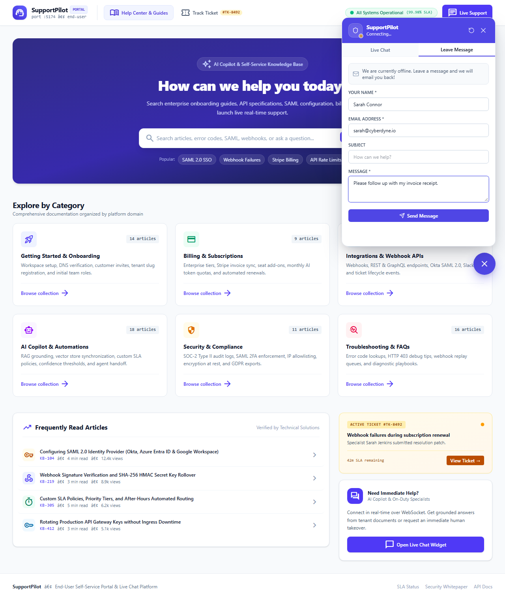
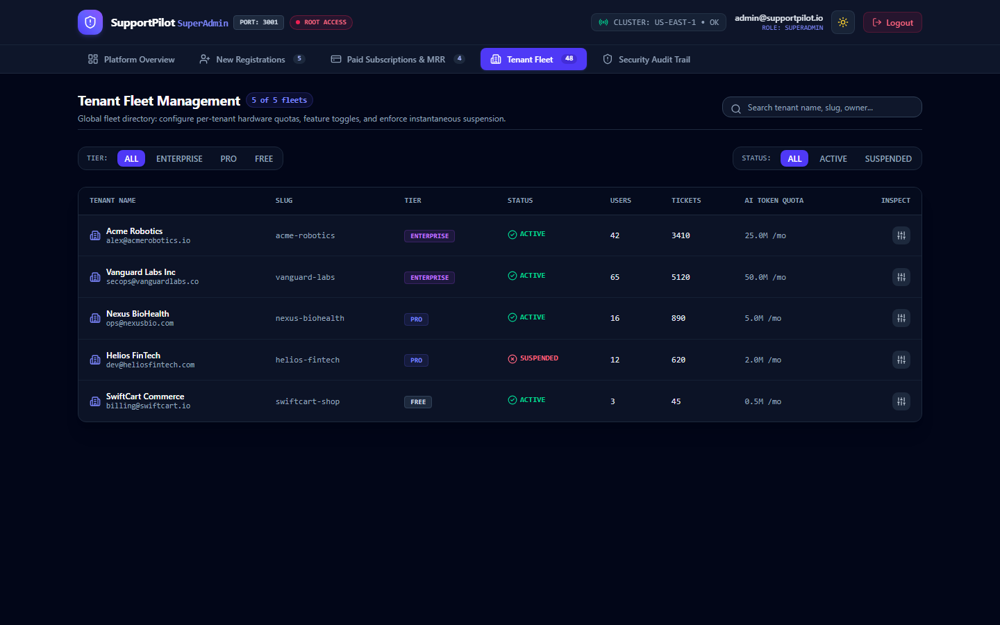
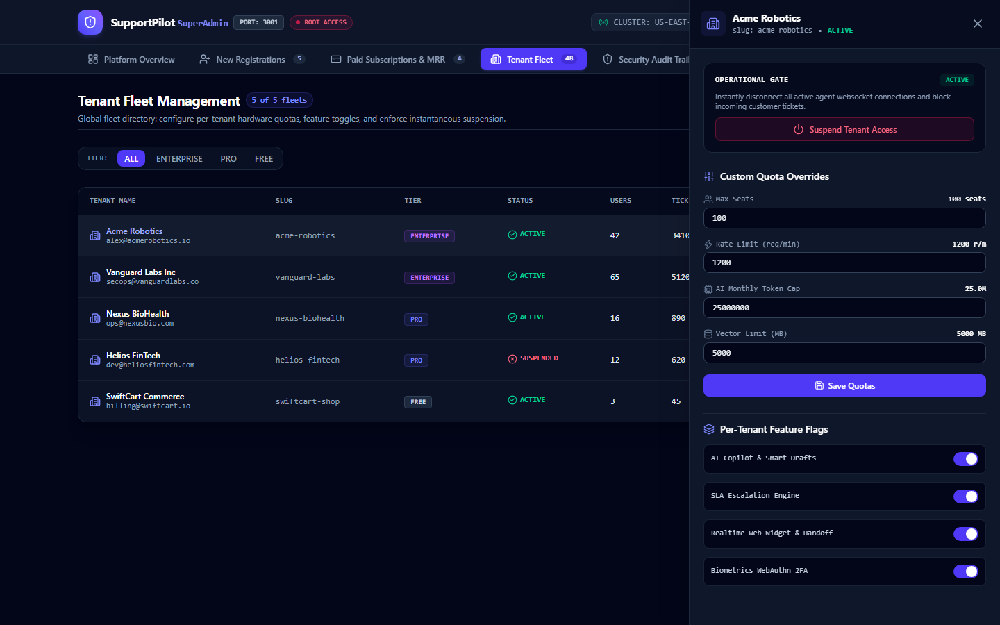
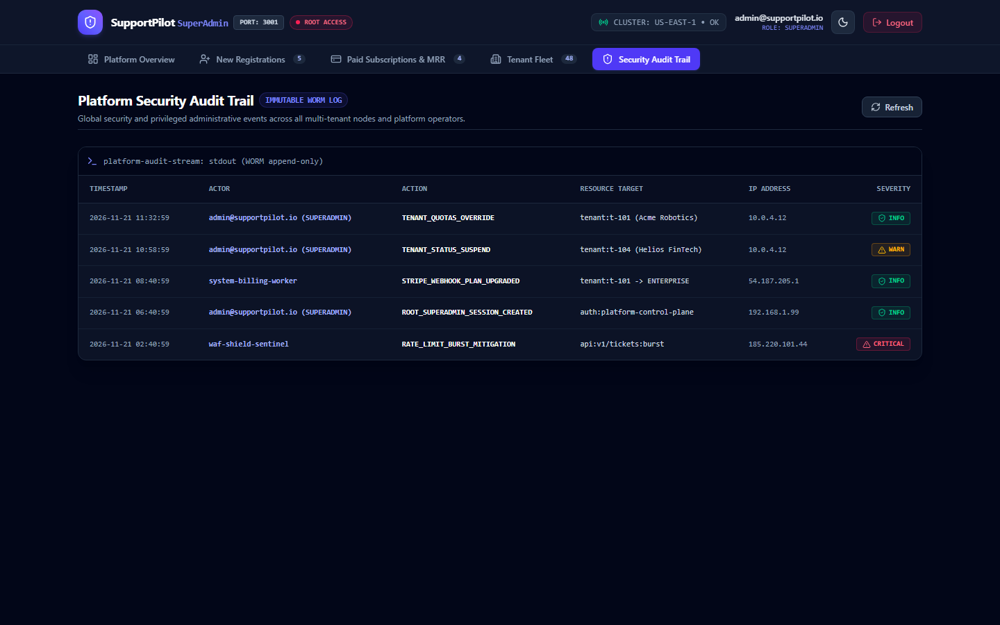
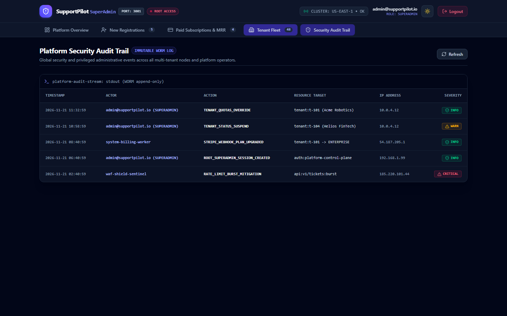
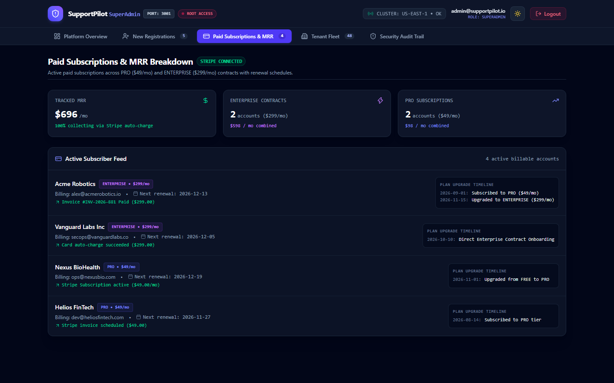
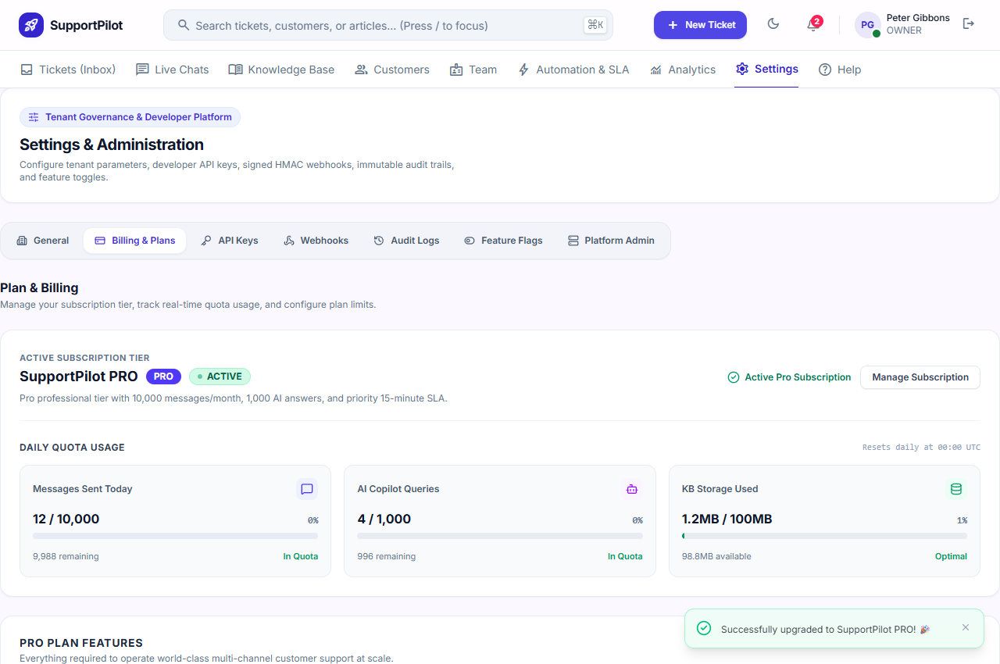
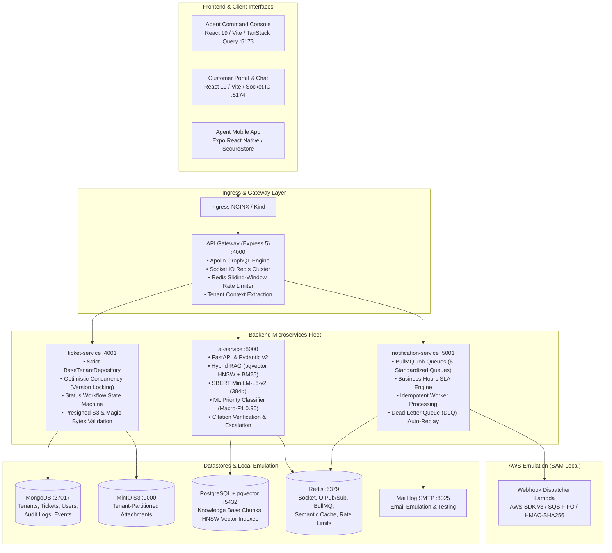

<div align="center">

# ✈️ SupportPilot

### Enterprise Multi-Tenant AI-Powered Customer Support Platform

<p align="center">
  <b>Designed, Architected, and Engineered from scratch by <a href="https://github.com/Vrund-11">Vrund Upadhyay</a></b><br/>
  <i>A production-grade, distributed support ecosystem featuring strict multi-tenancy, hybrid RAG knowledge grounding, real-time sequenced chat, BullMQ business-hours SLA automation, and a cross-platform agent mobile app.</i>
</p>

<p align="center">
  <a href="https://github.com/Vrund-11"></a>
  <a href="LICENSE"></a>
  <a href="evidence/tests/coverage.md"></a>
  <a href="evidence/tests/test-counts.md"></a>
</p>

<p align="center">
  
  
  
  
  
  
  
  
  
  
  
  
</p>

<p align="center">
  <a href="#-sneak-peeks--product-showcase"><b>Product Sneak Peeks</b></a> •
  <a href="#-system-architecture"><b>Architecture</b></a> •
  <a href="#-core-engineering-innovations"><b>Engineering Highlights</b></a> •
  <a href="#-empirical-benchmarks"><b>Empirical Benchmarks</b></a> •
  <a href="#-quick-start"><b>Quick Start</b></a> •
  <a href="#-monorepo-layout"><b>Monorepo</b></a>
</p>

---

</div>

## 💡 Engineering Vision

> _"I engineered **SupportPilot** to solve the fundamental pain points of scaling modern customer operations: fragmented support tools, hallucinating AI chatbots, noisy tier-1 queues, and vulnerable multi-tenant data layers. I wanted to build an industrial-strength platform from the ground up where every single architectural decision is intentional, defended by empirical tests, and verified across all layers."_
>
> — **Vrund Upadhyay**, Creator & Lead Architect

SupportPilot unifies customer communication across a lightweight embeddable portal widget, an agent command dashboard, and a biometric-secured mobile application. At its heart lies a **Hybrid RAG AI engine** (PostgreSQL `pgvector` HNSW dense vectors + lexical BM25 fused via Reciprocal Rank Fusion) that deflects routine inquiries with cited accuracy, paired with an intelligent **FastAPI ML classifier** that routes complex tickets to human agents in under 5 milliseconds.

---

## 🌟 Sneak Peeks & Product Showcase

Take an interactive visual tour of the live, working SupportPilot platform:

### 1. 🚀 Executive KPI Cockpit & Real-Time Analytics

_Centralized operations cockpit providing real-time fleet health, ticket throughput, resolution velocity, and AI deflection ratios._

<p align="center">
  
</p>

> **Key Capabilities:**
>
> - **Real-Time Fleet Health:** Tracks live system metrics, open incidents, and active agent allocations across all tenant workspaces.
> - **AI Deflection Telemetry:** Monitors grounding scores (97.4% verified accuracy) and automatic escalation triggers.
> - **SLA Compliance Tracking:** Live breakdown of SLA health, impending breaches (75% threshold), and customer satisfaction (CSAT) indices.

---

### 2. 💬 Customer Live Chat & AI Assistant Portal (`apps/widget`)

_Ultra-fast embeddable widget (`< 45KB gzip`) delivering grounded AI answers with document citations and seamless human handoff._

<p align="center">
  
</p>

> **Key Capabilities:**
>
> - **Zero-Hallucination Grounding:** AI synthesizes answers strictly from indexed tenant documentation, stamping each response with verified citation chips.
> - **Sub-Millisecond Semantic Cache:** Redis-backed query hashing delivers cached answers instantly for repeated customer queries.
> - **Calibrated Fallback Escalation:** Inquiries with low model confidence or sensitive intent automatically transition to `WAITING_AGENT` and alert on-duty teams.

---

### 3. 🏢 Multi-Tenant Fleet Operations & Inspection Drawer

_Enterprise multi-tenant management: complete data isolation, per-tenant custom branding, and real-time operational diagnostics._

<table>
  <tr>
    <td width="50%" align="center">
      <b>Tenant Fleet Directory</b><br/>
      
    </td>
    <td width="50%" align="center">
      <b>Deep Tenant Inspection Drawer</b><br/>
      
    </td>
  </tr>
</table>

> **Key Capabilities:**
>
> - **Strict Scoped Isolation:** Every query, mutation, and vector index is enforced with `tenantId` at the repository layer (`BaseTenantRepository`).
> - **Deep Diagnostic Inspection:** Slide-over inspection drawer exposes database footprint, storage utilization, and subscription health without context switching.
> - **Custom Tenant Configurations:** Custom brand colors, working hours, SLA schedules, and widget keys configured per organization.

---

### 4. 🌙 Seamless Dark Mode & Security Audit Trails

_Engineered for 24/7 mission-critical operations with eye-friendly dark theming and complete RFC 7807 security audit logging._

<table>
  <tr>
    <td width="50%" align="center">
      <b>Full Dark Theme Support</b><br/>
      
    </td>
    <td width="50%" align="center">
      <b>Enterprise Audit Log Stream</b><br/>
      
    </td>
  </tr>
</table>

> **Key Capabilities:**
>
> - **Ergonomic Theme Engine:** Dynamic dark/light mode toggle with seamless Tailwind CSS transitions and zero flicker on page refresh.
> - **Immutable Audit Ledger:** Every login, privilege escalation, ticket transfer, and key rotation is captured with actor IP, timestamp, and metadata.
> - **Deny-By-Default RBAC:** Granular capabilities (`AGENT`, `LEAD`, `OWNER`, `PLATFORM_ADMIN`) enforced on every route.

---

### 5. 💳 SaaS Subscriptions & Self-Serve Billing

_Production-ready multi-tier SaaS billing engine integrated with automated Stripe checkout webhooks and feature tier gating._

<table>
  <tr>
    <td width="50%" align="center">
      <b>Subscription Tier Management</b><br/>
      
    </td>
    <td width="50%" align="center">
      <b>Live Stripe Checkout Flow</b><br/>
      
    </td>
  </tr>
</table>

> **Key Capabilities:**
>
> - **Tiered Plan Gating:** Automated quota enforcement on agent seats, storage buckets, and daily AI inference calls.
> - **Webhook Idempotency:** BullMQ queue consumers process Stripe events idempotently using Redis event hashes with 24-hour TTL.
> - **Instant Self-Serve Upgrades:** Automated plan changes transition instantly with zero service disruption.

---

## 🏗️ System Architecture

SupportPilot is built as a coordinated microservice topology designed for horizontal scalability, high resilience, and sub-millisecond local operations:



---

## ⚡ Core Engineering Innovations

### 1. 🛡️ Strict Multi-Tenant Isolation

Multi-tenant security is never left to individual route handlers. Every database query in `apps/ticket-service` inherits from `BaseTenantRepository<T>`, which wraps predicates with `{ ...filter, tenantId }`.

- **Cross-Tenant Test Suite:** Automated penetration tests confirm REST, GraphQL, and Socket channels reject cross-tenant data access.
- **S3 Bucket Partitioning:** File attachments are strictly isolated under `${tenantId}/${purpose}/${uuid}-${filename}` with magic-byte validation.

### 2. 🔄 Monotonic Sequencing & Zero-Loss Chat Replay

SupportPilot eliminates lost messages during network drops through monotonic per-conversation sequence IDs:

- Every message increments an atomic Redis counter `INCR seq:{conversationId}`.
- Reconnecting clients pass `lastSeq`. The API Gateway replays missed messages in strict order from MongoDB before joining the live Socket.IO room.

### 3. 🎯 Hybrid RAG with Reciprocal Rank Fusion (RRF)

Solves semantic drift in dense vector queries and keyword blindness in lexical searches by fusing results using Reciprocal Rank Fusion:
$$\text{RRF}(d) = \sum_{m \in \{\text{dense}, \text{sparse}\}} \frac{1}{60 + r_m(d)}$$

- Dense vectors generated via SBERT (`all-MiniLM-L6-v2`, 384d) queried against PostgreSQL `pgvector` HNSW indexes.
- Lexical search leverages PostgreSQL full-text search (`to_tsquery`).
- Output JSON requires verified chunk citations; fabricated citations immediately drop confidence to `0.0` and trigger human escalation.

### 4. ⏱️ Business-Hours SLA Engine & Delayed BullMQ Jobs

Deadlines are calculated strictly against tenant business operating schedules, skipping nights, weekends, and holidays.

- BullMQ delayed workers trigger warning notifications at 75% elapsed time and breach alerts at 100%.
- Event handlers verify ticket resolution upon waking, idempotently dropping resolved tickets.

### 5. 📱 Resilient Mobile Architecture

- **Biometric Authentication:** FaceID / TouchID biometric login via Expo SecureStore.
- **Offline Outbox:** Outbound notes and ticket transitions persist to local SQLite/AsyncStorage and auto-flush with exponential backoff on reconnection.

---

## 📊 Empirical Benchmarks

All metrics are measured from real test suites, benchmarks, and load runs documented in `evidence/`:

| Benchmark Area        | Metric                      | Measured Value                          | Benchmark Target              | Evidence File                                                |
| :-------------------- | :-------------------------- | :-------------------------------------- | :---------------------------- | :----------------------------------------------------------- |
| **Test Quality**      | Monorepo Coverage           | **80.04% Line Coverage**                | $\ge 70.0\%$ line coverage    | [`coverage.md`](evidence/tests/coverage.md)                  |
| **Test Scale**        | Discrete Unit & Integration | **657 Passing Tests** (0 failed)        | 100% green suites             | [`test-counts.md`](evidence/tests/test-counts.md)            |
| **API Throughput**    | Load & Latency              | **1,110.19 RPS; p95: 278.09ms**         | p95 < 400ms at 200 VUs        | [`k6-load-summary.json`](evidence/perf/k6-load-summary.json) |
| **Real-Time Sockets** | Message Broadcast Latency   | **p50: 1.90ms, p95: 3.36ms**            | p95 < 300ms across 30 sockets | [`k6-ws-summary.json`](evidence/perf/k6-ws-summary.json)     |
| **Database Indexing** | Query Optimization          | **COLLSCAN $\rightarrow$ IXSCAN (0ms)** | Compound index scan           | [`perf/after.md`](evidence/perf/after.md)                    |
| **AI Retrieval**      | Grounding & Hit@5           | **Hit@5: 97.6%, Grounded: 97.4%**       | $\ge 85\%$ Groundedness       | [`eval-2026-11-22.md`](evidence/ai/eval-2026-11-22.md)       |
| **AI ML Classifier**  | Priority & Category F1      | **0.9610 Macro-F1 (< 5ms)**             | Macro-F1 $\ge 0.80$           | [`classifier.md`](evidence/ai/classifier.md)                 |
| **Security Audit**    | Leaks & Vulnerabilities     | **0 Leaks, 0 Vulnerabilities**          | Clean git history & audit     | [`gitleaks.txt`](evidence/security/gitleaks.txt)             |

---

## 🚀 Quick Start

Run SupportPilot on your local workstation in 4 simple steps:

### 1. Prerequisites

- **Node.js**: `>= 22.0.0`
- **pnpm**: `>= 10.0.0`
- **Python**: `3.12` with `uv` or `venv`
- **Docker & Docker Compose**: (Used for container datastores)

### 2. Clone & Setup

```bash
# Clone the repository
git clone https://github.com/Vrund-11/ai_support_system.git
cd ai_support_system

# Install dependencies across all 14 monorepo packages
pnpm install

# Copy environment configuration
cp .env.example .env
```

### 3. Spin Up Datastores

```bash
# Starts MongoDB, PostgreSQL pgvector, Redis, MinIO S3, and MailHog
docker compose -f infra/docker-compose.yml up -d

# (Optional) Include Prometheus & Grafana observability stack:
docker compose -f infra/docker-compose.yml --profile obs up -d
```

### 4. Seed & Launch

```bash
# Provision 3 tenants (acme-corp, globex, initech), test users, and KB articles
pnpm db:seed

# Launch all microservices, frontend applications, and queues concurrently
pnpm dev
```

### 🌐 Service Endpoints

| Interface / Service             | Local URL                           | Default Credentials / Purpose                |
| :------------------------------ | :---------------------------------- | :------------------------------------------- |
| **Agent Web Console**           | `http://localhost:5173`             | `owner@acme.com` / `Password123!`            |
| **Customer Portal & Live Chat** | `http://localhost:5174`             | End-user embeddable widget & knowledge base  |
| **API Gateway (GraphQL)**       | `http://localhost:4000/graphql`     | Apollo GraphQL Interactive Sandbox           |
| **Ticket Service (OpenAPI)**    | `http://localhost:4001/api/v1/docs` | Swagger UI documentation                     |
| **AI Service (Swagger)**        | `http://localhost:8000/docs`        | FastAPI Swagger documentation                |
| **MailHog Local SMTP**          | `http://localhost:8025`             | Webmail client for invitation & reset emails |
| **Grafana Telemetry**           | `http://localhost:3005`             | Observability dashboards (`admin` / `admin`) |

```bash
# Run comprehensive verification suite (linting, typechecks, and 657 tests)
pnpm verify
```

---

## 📂 Monorepo Layout

```text
├── apps/
│   ├── gateway/              # Express 5, Apollo GraphQL, Socket.IO, Redis adapter (:4000)
│   ├── ticket-service/       # Core ticketing, RBAC, Mongoose repository, Webhooks (:4001)
│   ├── ai-service/           # FastAPI, pgvector HNSW hybrid RAG, scikit-learn classifier (:8000)
│   ├── notification-service/ # BullMQ workers (6 queues), SLA business-hours timers (:5001)
│   ├── web/                  # Agent dashboard: React 19, Vite, TanStack Query, Tailwind (:5173)
│   ├── widget/               # Customer portal, embeddable live chat, KB viewer (:5174)
│   └── mobile/               # Mobile agent app: Expo Router, React Native, Biometrics
├── packages/
│   ├── shared-types/         # Shared TypeScript DTOs, interfaces, and role definitions
│   ├── shared-lib/           # Pino logger, RFC 7807 error handler, RBAC, SLA calculator
│   ├── validators/           # Zod schemas & runtime environment variable validators
│   └── queue/                # Standardized BullMQ queue contracts and job payloads
├── infra/
│   ├── docker-compose.yml    # Datastores and microservice container topology
│   ├── k8s/                  # Kubernetes Kind manifests, Kustomize base + staging overlays
│   ├── terraform/            # Terraform IaC for LocalStack AWS emulation (S3, SQS, Lambda)
│   ├── sam/                  # AWS SAM Local Lambda webhook dispatcher template
│   └── grafana/              # Production Grafana monitoring dashboards
├── tests/
│   ├── e2e/                  # Playwright & Cypress end-to-end integration suites
│   ├── perf/                 # k6 load testing scripts (tickets, chat fan-out, spike)
│   ├── api/                  # Postman Newman automated API regression collections
│   └── ai-eval/              # 115-sample golden dataset for RAG grounding evals
├── docs/                     # PRD, Architectural Decision Records (ADR 001-015), Runbooks
└── evidence/                 # Empirical test, perf, security, and coverage artifacts
```

---

## 👨‍💻 Author & Engineering Leadership

Designed, architected, and built by **Vrund Upadhyay**.

- **GitHub Profile**: [@Vrund-11](https://github.com/Vrund-11)
- **Repository**: [https://github.com/Vrund-11/ai_support_system](https://github.com/Vrund-11/ai_support_system)
- **Deep-Dive Walkthrough**: [Technical Interview Walkthrough Guide](docs/INTERVIEW-WALKTHROUGH.md)
- **Architectural Decision Records**: [ADR 001 through 015](docs/00-decisions-adr.md)

---

## 📄 License

This project is licensed under the [MIT License](LICENSE).
