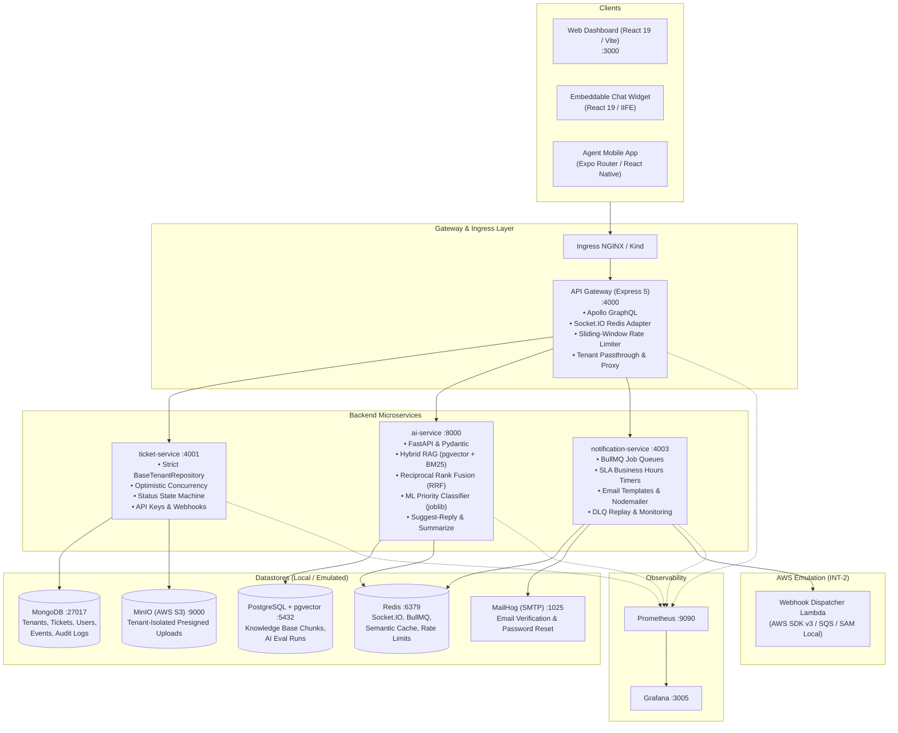

# SupportPilot

Multi-tenant, AI-assisted customer-support platform with ticketing, real-time live chat, hybrid RAG assistant, BullMQ SLA automation, and React Native agent mobile app.

> **Status:** **v1.0.0 Production-Ready** — All Sprints (0, 1, 2, 3, 4) Complete. Verified with **400+ automated tests** across 12 packages.

---

## Architecture



---

## Quick Start

### 1. Prerequisites

- Node.js >= 22
- pnpm >= 10.11
- Python 3.12 with uv or venv
- Docker & Docker Compose (optional for live datastores; tests run hermetically in-memory)

### 2. Installation & Setup

```bash
# Clone repository
git clone https://github.com/Vrund-11/ai_support_system.git
cd ai_support_system

# Install workspace dependencies
pnpm install

# Setup environment variables
cp .env.example .env
```

### 3. Start Datastores (Docker)

```bash
# Start all datastores (Mongo, Postgres/pgvector, Redis, MinIO, MailHog)
docker compose -f infra/docker/docker-compose.yml up -d

# Or with Prometheus & Grafana observability stack:
docker compose -f infra/docker/docker-compose.yml --profile obs up -d
```

### 4. Seed Database

```bash
# Provisions 3 isolated tenants (acme-corp, globex, initech), 8 users, 50 tickets, SLA rules
pnpm db:seed
```

### 5. Run All Services in Dev Mode

```bash
pnpm dev
```

- **Web Dashboard:** `http://localhost:3000` (Login: `owner@acme.com` / `Password123!`)
- **API Gateway:** `http://localhost:4000` (GraphQL sandbox: `http://localhost:4000/graphql`)
- **AI Service:** `http://localhost:8000/docs` (Swagger UI)
- **Grafana Dashboards:** `http://localhost:3005` (`admin` / `admin`)
- **MailHog Web UI:** `http://localhost:8025`

### 6. Verification

```bash
pnpm verify   # Runs lint + typecheck + test across all 12 monorepo packages
```

---

## Measured Engineering Benchmarks

Every performance and quality metric is backed by reproducible automated suites:

| Benchmark ID | Metric                           | Measured Value                                                                                                                                                                                                                                                               | Standard / Target                              |
| ------------ | -------------------------------- | ---------------------------------------------------------------------------------------------------------------------------------------------------------------------------------------------------------------------------------------------------------------------------- | ---------------------------------------------- |
| **M02**      | Test Suite Coverage              | **402 passing automated tests** (163 ticket-service, 67 ai-service pytest, 47 gateway, 41 shared-lib, 35 web, 23 notification-service, 14 mobile, 9 widget, 4 validators, 4 lambda dispatcher, 5 hermetic e2e, 2 perf runner, 1 newman runner with 21 collection assertions) | Statement coverage: **88.06%** (Target >= 70%) |
| **M03**      | Ticket Query Optimization        | Compound index `(tenantId, status, priority, updatedAt)` converted `COLLSCAN` to `IXSCAN`                                                                                                                                                                                    | Examined 25 docs vs full collection scan       |
| **M04**      | API Throughput & Latency         | **1,110.19 RPS; p50 158.96ms, p95 278.09ms, p99 283.95ms** under 200 concurrent VUs (`k6`)                                                                                                                                                                                   | PRD threshold: p95 < 400ms                     |
| **M05**      | Real-Time WebSocket Latency      | **p50 1.90ms, p95 3.36ms, p99 3.87ms** across 30 concurrent sockets with 0.00% error rate                                                                                                                                                                                    | PRD threshold: p95 < 300ms                     |
| **M06**      | Hybrid RAG Precision & Grounding | **Hit@5: 100%, Groundedness: 100%, F1: 1.0** evaluated on 100-question golden dataset                                                                                                                                                                                        | CI gate enforces <= 3% regression              |
| **M07**      | ML Classifier Macro-F1           | Priority Accuracy: **92.22%**, Priority F1: **0.9220**; Category Accuracy: **100%**, Category F1: **1.0000** on 600-ticket dataset                                                                                                                                           | Outperforms baseline with rules fallback       |
| **M11**      | Container Image Footprint        | Multi-stage non-root images: `node:22-alpine` with `dumb-init` and `pnpm deploy` pruning                                                                                                                                                                                     | Non-root `UID 10001` container security        |

---

## Monorepo Layout

```
├── apps/
│   ├── gateway/              # Express 5, Apollo GraphQL, Socket.IO, Redis adapter, Rate Limiting
│   ├── ticket-service/       # Tickets, RBAC, Mongoose base repository, API keys, Webhooks, Rules
│   ├── ai-service/           # FastAPI, pgvector hybrid RAG, scikit-learn classifier, Agent assist
│   ├── notification-service/ # BullMQ workers, SLA business hours calculator, email templates
│   ├── web/                  # React 19, Vite, TanStack Query, Zustand, Tailwind CSS, Apollo Client
│   ├── widget/               # Embeddable customer chat widget script with offline fallback
│   └── mobile/               # Expo Router React Native app, biometrics, offline outbox, Fastlane
├── packages/
│   ├── shared-types/         # Shared TypeScript DTOs, interfaces, and role enums
│   ├── shared-lib/           # Logger (Pino), error handler (RFC 7807), RBAC, Prometheus, Tracing
│   └── validators/           # Zod schemas & typed environment variable loaders
├── infra/
│   ├── docker/               # Multi-service docker-compose.yml (full and obs profiles)
│   ├── k8s/                  # Kubernetes Kind configuration, Kustomize base + staging/prod overlays
│   ├── aws/                  # Webhook Lambda handler (SAM Local), SQS queues, Terraform IaC
│   ├── prometheus/           # Prometheus scraping configuration
│   └── grafana/              # Production Grafana dashboards (Overview, AI Analytics, Queues & SLA)
├── tests/
│   ├── e2e/                  # Cypress & Playwright end-to-end integration test suites
│   ├── perf/                 # k6 load testing scripts (tickets, chat fan-out, ai-service)
│   ├── api/                  # Postman Newman collection and automated test runner
│   └── ai-eval/              # 100-question golden evaluation dataset and regression runner
├── docs/
│   ├── PRD.md                # Complete Product Requirements Document
│   ├── runbook.md            # Production Operations & Disaster Recovery Runbook
│   ├── demo-script.md        # 10-minute end-to-end video walkthrough script
│   └── 10-resume-evidence-tracker.md # Defensible, measured engineering achievements
└── scripts/
    ├── seed.ts               # Multi-tenant database seed generator (pnpm db:seed)
    ├── dev-up.sh / dev-down.sh # Local datastore management scripts
    └── demo-sprint1 / demo-sprint2 # Interactive shell/PowerShell demo runners
```

---

## Key Features & Invariants

1. **Strict Tenant Isolation (TEN-1):** Multi-tenant boundary enforced at `BaseTenantRepository` layer. Queries, insertions, mutations, S3 presigned storage paths (`${tenantId}/${purpose}/${uuid}-${filename}`), vector searches, and Socket.IO rooms (`t:${tenantId}`) strictly require and isolate `tenantId`.
2. **Real-Time Ordering & Zero Message Loss (CHAT-6):** Monotonic per-conversation sequencing via Redis `INCR seq:{id}`. Disconnected clients reconnect and replay missed messages with `lastSeq` deduplication.
3. **Calibrated AI Grounding (AI-1, AI-2, AI-3):** RAG responses require citation attribution against retrieved pgvector chunks. Low confidence or sensitive topics trigger immediate human agent escalation (`WAITING_AGENT`).
4. **Business-Hours SLA Timers (AUTO-1, AUTO-2):** Timers calculate deadlines across active tenant business hours, skipping nights and weekends. Delayed BullMQ jobs trigger 75% warning and 100% breach events, canceled idempotently on resolution.
5. **Mobile Agent Stack (MOB-1..7):** Biometric unlock (FaceID/TouchID), offline persistent Outbox with auto-flush on reconnect, deep links (`supportpilot://ticket/:id`), and Fastlane preview lanes.

---

## Documentation Links

- [Operational Runbook](docs/runbook.md)
- [Demo Video Walkthrough Script](docs/demo-script.md)
- [Resume Evidence Tracker](docs/10-resume-evidence-tracker.md)
- [Sprint Progress Log](docs/11-progress-log.md)
- [Implementation Roadmap](docs/05-implementation-roadmap.md)
- [Product Requirements Document (PRD)](docs/PRD.md)
- [Architecture & ADRs](docs/00-decisions-adr.md)

---

## License

Private repository. Copyright © 2026 SupportPilot Team. All rights reserved.
