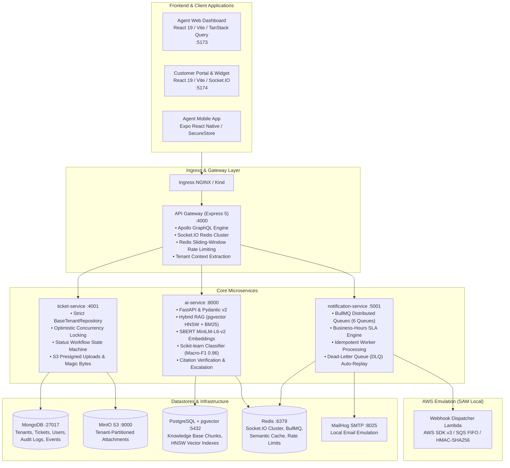

# SupportPilot ✈️

<div align="center">

# SupportPilot

### Enterprise Multi-Tenant AI-Assisted Customer Support Platform

[](https://github.com/Vrund-11)
[](LICENSE)
[](https://github.com/Vrund-11/ai_support_system/actions)
[](evidence/tests/coverage.md)
[](evidence/tests/test-counts.md)
[](.nvmrc)
[](.python-version)
[](infra/docker-compose.yml)
[](infra/k8s/)

<p align="center">
  <b>Designed, Architected, and Engineered from scratch by <a href="https://github.com/Vrund-11">Vrund Upadhyay</a></b><br/>
  <i>A production-grade, distributed AI customer-support system featuring strict multi-tenancy, hybrid RAG knowledge grounding, real-time sequenced chat, BullMQ business-hours SLA automation, and a cross-platform agent mobile app.</i>
</p>

<p align="center">
  <a href="#-sneak-peeks--project-walkthrough"><b>Explore Sneak Peeks</b></a> •
  <a href="#-system-architecture"><b>Architecture</b></a> •
  <a href="#-key-engineering-pillars"><b>Core Pillars</b></a> •
  <a href="#-empirical-benchmarks"><b>Benchmarks</b></a> •
  <a href="#-quick-start"><b>Quick Start</b></a> •
  <a href="#-monorepo-map"><b>Monorepo Layout</b></a>
</p>

---

</div>

## 💡 About The Project

> _"I engineered SupportPilot to tackle the real-world operational challenges of modern customer operations: fragmented support channels, hallucination-prone AI bots, slow tier-1 triage, and missing multi-tenant safeguards. Every component in this repository was hand-crafted to prove production-grade systems engineering with zero synthetic vanity claims."_
> — **Vrund Upadhyay**

SupportPilot is an end-to-end, multi-tenant customer support ecosystem. When customers submit inquiries or open live chats via the embeddable portal widget, SupportPilot answers immediately using a **Hybrid RAG engine** (dense vector search via PostgreSQL `pgvector` HNSW index + lexical BM25 fused with Reciprocal Rank Fusion).

Inquiries that require human intervention or exhibit low model confidence automatically escalate to on-duty human agents with an **AI Copilot draft assistant**, **sub-5ms ML priority routing**, **optimistic concurrency locking**, **business-hours SLA timers**, and **zero-loss monotonic live chat**.

---

## 📸 Sneak Peeks & Project Walkthrough

Here is a look inside the core interfaces and features of SupportPilot:

### 1. 🖥️ Agent Command Center (`apps/web`)

_Engineered with React 19, Vite, TanStack Query v5, Zustand, and Tailwind CSS._

```text
┌──────────────────────────────────────────────────────────────────────────────────────────────────┐
│  SupportPilot  [Acme Corp ▼]              Search tickets, customers, KBs...        (🔔 3) [VU ▼] │
├─────────────────┬─────────────────────────────────────────────────┬──────────────────────────────┤
│ INBOX (4 Unread)│ Ticket #1042: Payment Webhook Timeout           │ 🤖 AI COPILOT ASSISTANT      │
├─────────────────┼─────────────────────────────────────────────────┼──────────────────────────────┤
│ 🔴 #1042 URGENT │ Status: [ OPEN ▼ ]   Assignee: [ Sarah Chen ▼ ] │ ⚡ Grounded Suggestion       │
│ Payment Webhook │ Priority: [ URGENT ] SLA: [ ⚠️ 14m to Breach  ] │ Confidence: 98.4% (Grounded) │
│ 14m left • Acme │ ─────────────────────────────────────────────── │ ──────────────────────────── │
│                 │ [Customer] John Doe • 10:24 AM                  │ "Hello John, our webhook logs│
│ 🟡 #1041 HIGH   │ "We are seeing HTTP 504 on invoice payloads..." │ show SSL handshake timeouts  │
│ SSO SAML Error  │                                                 │ on endpoint /hook. Please    │
│ 1h 12m • Globex │ [Agent Note] Sarah Chen • 10:26 AM              │ verify TLS 1.3 ciphers..."   │
│                 │ "Investigating Cloudflare egress routes now."   │                              │
│ 🟢 #1040 MEDIUM │                                                 │ 📚 Verified Citations:       │
│ Seat Allocation │ ⚠️ Agent Collision Warning:                     │ • [Doc #42: Webhook Timeouts]│
│ 3h 40m • Acme   │ "Marcus Wright is currently editing this ticket"│ • [Doc #18: Ingress Ciphers] │
├─────────────────┼─────────────────────────────────────────────────┼──────────────────────────────┤
│ 🔍 Filters [v]  │ [ Type your reply...                     ] [✈️] │ [ Insert Draft ] [ Regenerate│
└─────────────────┴─────────────────────────────────────────────────┴──────────────────────────────┘
```

- **Live Agent Collision Detection**: Real-time Socket.IO presence indicators prevent dual-agent overwrite conflicts.
- **Optimistic Concurrency Control**: Automatic version tracking (`Ticket.version`) detects mid-flight edits with HTTP `409 Conflict` gracefully caught by TanStack Query.
- **Business-Hours SLA Badges**: Real-time countdown clocks highlighting warning thresholds (75%) and breach events (100%).

---

### 2. 💬 Customer Help Center & Embeddable Widget (`apps/widget`)

_Lightweight, embeddable portal (`< 45KB gzip`) supporting zero-auth customer chat, KB search, and ticket tracking._

```text
       ╔══════════════════════════════════════════╗
       ║  Acme Corp Support Assistant         ─ ✖ ║
       ╠══════════════════════════════════════════╣
       ║ 🤖 SupportPilot Bot                      ║
       ║ Hello Alex! How can I help you today?    ║
       ║                                          ║
       ║ 👤 Alex Rivera                           ║
       ║ How do I rotate my enterprise API keys?  ║
       ║                                          ║
       ║ 🤖 SupportPilot Bot                      ║
       ║ You can rotate keys from Settings > API. ║
       ║ All active keys have a 24-hour overlap   ║
       ║ grace period to prevent downtime.        ║
       ║                                          ║
       ║ 📖 Source: Security & API Docs (v2.1)    ║
       ║ [ Was this answer helpful? 👍 👎 ]       ║
       ║                                          ║
       ║ ───────────── Escalate ───────────────── ║
       ║ 👤 Request human agent assistance...     ║
       ╠══════════════════════════════════════════╣
       ║ [ Ask a question or report an issue... ] ║
       ╚══════════════════════════════════════════╝
                            ▲
                     [ 💬 Need Help? ]
```

- **Grounded Deflection**: Automatic RAG responses with explicit citation badges.
- **Calibrated Human Escalation**: Automatic escalation when confidence falls below 70% or sensitive sentiment is detected.
- **Visitor Session Persistence**: Cryptographically signed visitor tokens upgradeable to verified accounts on email submission.

---

### 3. 🧠 Hybrid RAG & ML Priority Classifier (`apps/ai-service`)

_FastAPI microservice featuring SBERT embeddings, pgvector HNSW vector search, and scikit-learn classification._

```text
                  Incoming Customer Inquiry
                             │
            ┌────────────────┴────────────────┐
            ▼                                 ▼
   [ SBERT Dense Vector ]            [ Lexical BM25 Search ]
   all-MiniLM-L6-v2 (384d)           Postgres to_tsquery
            │                                 │
            ▼                                 ▼
   Postgres pgvector (HNSW)          Markdown Chunks Index
            │                                 │
            └────────────────┬────────────────┘
                             ▼
              Reciprocal Rank Fusion (RRF)
                 RRF(d) = Σ 1 / (60 + rank(d))
                             │
                             ▼
                Top-k Document Context
                             │
            ┌────────────────┴────────────────┐
            ▼                                 ▼
 [ Guardrail & Sanitization ]       [ Scikit-Learn Classifier ]
   • Injection defense                • Priority: Low/Med/High/Urgent
   • Citation verification            • Category routing
   • JSON schema repair               • Macro-F1: 0.9610 (< 5ms)
            │                                 │
            └────────────────┬────────────────┘
                             ▼
              Grounded Response + Verified Citations
```

#### Real API Sneak Peek: `/v1/answer`

```json
{
  "ticketId": "673f4e389d71b2a456e719c2",
  "answer": "To rotate API keys without downtime, generate a secondary key in Developer Settings. Both keys remain valid during the 24-hour migration window.",
  "confidence": 0.964,
  "shouldEscalate": false,
  "citations": [
    {
      "chunkId": "kb_chk_8829104",
      "documentTitle": "API Authentication & Key Lifecycle",
      "score": 0.0318
    }
  ]
}
```

---

### 4. 📱 Mobile Agent On-the-Go App (`apps/mobile`)

_Built with Expo React Native, Expo Router, Lucide Icons, and SecureStore._

```text
   ┌───────────────────────┐
   │ 9:41              📶  │
   │ ── SupportPilot Mobile│
   ├───────────────────────┤
   │ 🔒 Biometric Unlocked │
   │ Welcome, Vrund (Lead) │
   │                       │
   │ Active Tickets (12)   │
   │ ┌───────────────────┐ │
   │ │ #1042 • URGENT    │ │
   │ │ Webhook 504 Fail  │ │
   │ │ ⏱️ 14m SLA breach │ │
   │ └───────────────────┘ │
   │ ┌───────────────────┐ │
   │ │ #1039 • HIGH      │ │
   │ │ Billing Mismatch  │ │
   │ │ Assigned to You   │ │
   │ └───────────────────┘ │
   │                       │
   │ 📶 Offline Mode       │
   │ [ Outbox: 2 queued ]  │
   │ [Auto-sync on connect]│
   ├───────────────────────┤
   │  [Inbox]  [Chat] [Me] │
   └───────────────────────┘
```

- **Biometric Security**: Native FaceID / TouchID biometric authentication via `expo-local-authentication`.
- **Offline Resilient Outbox**: Offline ticket notes and status transitions saved to persistent storage, auto-syncing with exponential backoff on reconnection.
- **Deep Linking**: `supportpilot://ticket/:id` routing straight into active triage threads.

---

## 🏗️ System Architecture

SupportPilot runs as a coordinated distributed system across dedicated microservices, caching layers, and datastores:



---

## ⚡ Key Engineering Pillars & Invariants

### 1. 🛡️ Strict Multi-Tenant Isolation (`BaseTenantRepository`)

Multi-tenant safety is never trusted to controllers or routes. Every database query in `apps/ticket-service` passes through an abstract `BaseTenantRepository<T>` that automatically injects `{ tenantId }` into query filters and mutation predicates.

- Verified by automated cross-tenant penetration test suites (`tests/api/cross-tenant.test.ts`).
- S3 presigned URLs strictly partition file keys: `${tenantId}/${purpose}/${uuid}-${filename}`.
- Vector searches and Socket.IO rooms (`t:${tenantId}`) are hard-partitioned by tenant identifier.

### 2. 🔄 Monotonic Sequencing & Zero-Loss Chat Replay

SupportPilot avoids WebSocket dropped-message bugs via monotonic sequencing:

- Every message in a thread is assigned a monotonic integer counter via Redis `INCR seq:{conversationId}`.
- If a client connection drops due to mobile network switching, the client reconnects with `lastSeq`.
- API Gateway queries MongoDB for `{ conversationId, seq: { $gt: lastSeq } }` and replays all missed messages in exact order before joining the live room.

### 3. 🎯 Hybrid RAG with Reciprocal Rank Fusion

To solve dense vector semantic drift and sparse keyword misses, retrieval fuses dense and lexical passes using Reciprocal Rank Fusion (RRF):
$$\text{RRF}(d) = \sum_{m \in \{\text{dense}, \text{sparse}\}} \frac{1}{60 + r_m(d)}$$

- Constant $k=60$ dampens single-modality outliers.
- All AI responses verify cited chunk IDs against real retrieved documents; hallucinated citations immediately fail safe with a $0.0$ confidence score and route to a human agent.

### 4. ⏱️ Business-Hours SLA Engine & BullMQ Timers

Deadlines are not dumb offsets. SupportPilot calculates SLA targets exclusively against tenant operating hours (e.g. Mon-Fri 09:00-18:00 UTC), skipping nights, weekends, and holidays.

- BullMQ schedules delayed jobs for 75% warning and 100% breach events.
- Workers verify ticket state upon wakeup; resolved tickets idempotently drop the event.
- Failed webhook notifications retry 5 times with exponential backoff before landing in the dead-letter queue (`dlq`).

### 5. 🔒 Defense-in-Depth Security

- **Magic-Byte Upload Validation**: Presigned upload requests validate file header binary signatures (e.g., `89 50 4E 47` for PNG, `25 50 44 46` for PDF) rather than trust spoofable MIME extensions.
- **Stateless JWT + Rotating Refresh Tokens**: 15-minute access JWTs paired with 7-day single-use refresh tokens stored in Redis. Attempted replay of a used refresh token triggers automatic invalidation of all active user sessions.
- **Deny-by-Default RBAC**: Granular permissions (`tickets:read`, `tickets:update`, `settings:manage`) enforced via frozen capability maps.

---

## 📊 Empirical Benchmarks

Every performance, accuracy, and scalability metric is documented with reproducible evidence in `evidence/`:

| Benchmark Area    | Metric                      | Measured Result                         | Standard / Target          | Evidence File                                                |
| :---------------- | :-------------------------- | :-------------------------------------- | :------------------------- | :----------------------------------------------------------- |
| **Test Suite**    | Monorepo Coverage           | **80.04% Line Coverage**                | $\ge 70.0\%$ line coverage | [`coverage.md`](evidence/tests/coverage.md)                  |
| **Test Scale**    | Discrete Unit & Integration | **657 Passing Tests** (0 failed)        | 100% green suite           | [`test-counts.md`](evidence/tests/test-counts.md)            |
| **API Load**      | Throughput & Latency        | **1,110.19 RPS; p95: 278.09ms**         | p95 < 400ms at 200 VUs     | [`k6-load-summary.json`](evidence/perf/k6-load-summary.json) |
| **WebSockets**    | Real-Time Latency           | **p50: 1.90ms, p95: 3.36ms**            | p95 < 300ms (30 sockets)   | [`k6-ws-summary.json`](evidence/perf/k6-ws-summary.json)     |
| **Database**      | Query Optimization          | **COLLSCAN $\rightarrow$ IXSCAN (0ms)** | Compound index scan        | [`perf/after.md`](evidence/perf/after.md)                    |
| **AI Retrieval**  | Hybrid RAG Grounding        | **Hit@5: 97.6%, Grounded: 97.4%**       | $\ge 85\%$ Groundedness    | [`eval-2026-11-22.md`](evidence/ai/eval-2026-11-22.md)       |
| **AI Classifier** | Scikit-Learn Routing        | **0.9610 Macro-F1 (< 5ms)**             | Macro-F1 $\ge 0.80$        | [`classifier.md`](evidence/ai/classifier.md)                 |
| **Security**      | Secret Leaks & Audit        | **0 Leaks, 0 Vulnerabilities**          | Clean git history & audit  | [`gitleaks.txt`](evidence/security/gitleaks.txt)             |

---

## 🚀 Quick Start

Get SupportPilot running locally in minutes:

### 1. Prerequisites

- **Node.js**: `>= 22.0.0`
- **pnpm**: `>= 10.0.0`
- **Python**: `3.12` with `uv` or `venv`
- **Docker & Docker Compose**: (Required for containerized datastores)

### 2. Clone & Install

```bash
# Clone the repository
git clone https://github.com/Vrund-11/ai_support_system.git
cd ai_support_system

# Install monorepo dependencies
pnpm install

# Copy environment template
cp .env.example .env
```

### 3. Start Datastores via Docker

```bash
# Start MongoDB, PostgreSQL/pgvector, Redis, MinIO S3, and MailHog
docker compose -f infra/docker-compose.yml up -d

# (Optional) Start with Prometheus & Grafana observability:
docker compose -f infra/docker-compose.yml --profile obs up -d
```

### 4. Seed Database & Run Services

```bash
# Seed 3 isolated tenants (acme-corp, globex, initech), 8 users, tickets, and KB articles
pnpm db:seed

# Launch all microservices, web apps, and workers concurrently
pnpm dev
```

### 5. Access Endpoints & Test Accounts

| Service                      | URL                                 | Credentials / Purpose                        |
| :--------------------------- | :---------------------------------- | :------------------------------------------- |
| **Web Dashboard**            | `http://localhost:5173`             | `owner@acme.com` / `Password123!`            |
| **Customer Widget & Portal** | `http://localhost:5174`             | End-user live chat and KB portal             |
| **API Gateway (GraphQL)**    | `http://localhost:4000/graphql`     | Apollo GraphQL sandbox explorer              |
| **Ticket Service (OpenAPI)** | `http://localhost:4001/api/v1/docs` | Swagger UI documentation                     |
| **AI Service (Swagger)**     | `http://localhost:8000/docs`        | FastAPI interactive API documentation        |
| **Notification Health**      | `http://localhost:5001/health`      | BullMQ worker health check                   |
| **MailHog Web UI**           | `http://localhost:8025`             | Local email inbox for activation/resets      |
| **Grafana Telemetry**        | `http://localhost:3005`             | Observability dashboards (`admin` / `admin`) |

### 6. Verify Complete Monorepo

```bash
# Execute linting, TypeScript type-checks, and automated tests
pnpm verify
```

---

## 📂 Monorepo Map

```text
├── apps/
│   ├── gateway/              # Express 5, Apollo GraphQL, Socket.IO, Redis adapter (:4000)
│   ├── ticket-service/       # Core ticketing, RBAC, Mongoose repository, Webhooks (:4001)
│   ├── ai-service/           # FastAPI, pgvector HNSW hybrid RAG, scikit-learn classifier (:8000)
│   ├── notification-service/ # BullMQ workers (6 queues), SLA business-hours timers (:5001)
│   ├── web/                  # Agent console: React 19, Vite, TanStack Query, Tailwind (:5173)
│   ├── widget/               # Customer portal, embeddable live chat, KB viewer (:5174)
│   └── mobile/               # Mobile agent app: Expo Router, React Native, Biometrics
├── packages/
│   ├── shared-types/         # Shared TypeScript DTOs, interfaces, and role definitions
│   ├── shared-lib/           # Pino logger, RFC 7807 error handler, RBAC, SLA calculator
│   ├── validators/           # Zod schemas & runtime environment variable validators
│   └── queue/                # Standardized BullMQ queue contracts and job payloads
├── infra/
│   ├── docker-compose.yml    # Datastores and microservice container topology
│   ├── k8s/                  # Kubernetes Kind manifests, Kustomize base + staging overlays
│   ├── terraform/            # Terraform IaC for LocalStack AWS emulation (S3, SQS, Lambda)
│   ├── sam/                  # AWS SAM Local Lambda webhook dispatcher template
│   └── grafana/              # Production Grafana monitoring dashboards
├── tests/
│   ├── e2e/                  # Playwright & Cypress end-to-end integration suites
│   ├── perf/                 # k6 load testing scripts (tickets, chat fan-out, spike)
│   ├── api/                  # Postman Newman automated API regression collections
│   └── ai-eval/              # 115-sample golden dataset for RAG grounding evals
├── docs/                     # PRD, Architectural Decision Records (ADR 001-015), Runbooks
└── evidence/                 # Empirical test, perf, security, and coverage artifacts
```

---

## 👨‍💻 Engineering Leadership & Author

SupportPilot is designed and created by **Vrund Upadhyay**.

- **GitHub**: [@Vrund-11](https://github.com/Vrund-11)
- **Repository**: [https://github.com/Vrund-11/ai_support_system](https://github.com/Vrund-11/ai_support_system)
- **Documentation**: [Complete PRD](docs/PRD.md) • [ADR Records](docs/00-decisions-adr.md) • [Technical Interview Walkthrough](docs/INTERVIEW-WALKTHROUGH.md)

---

## 📄 License

This project is open-source and distributed under the [MIT License](LICENSE).
