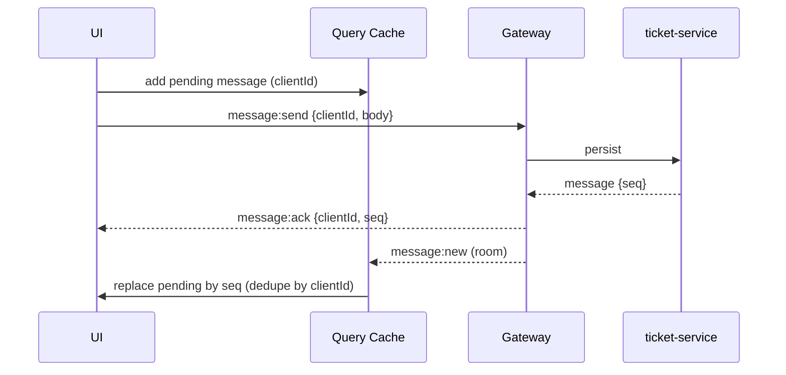
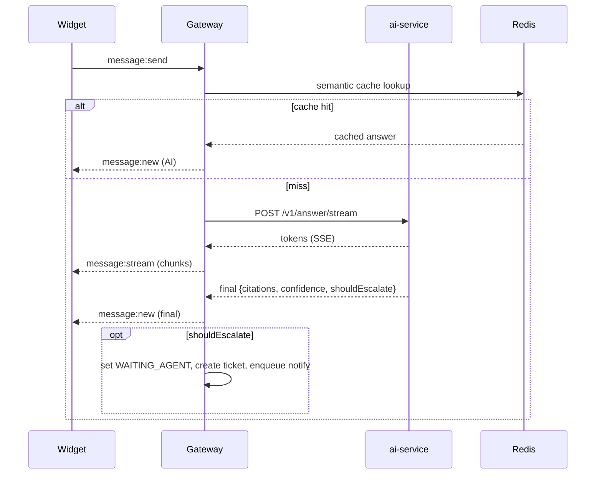
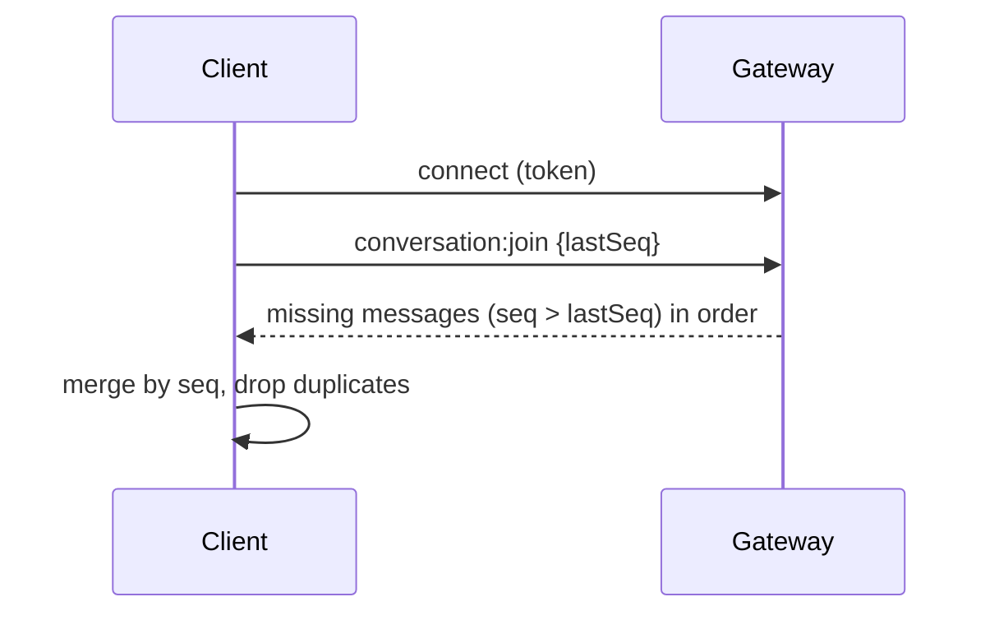

# Frontend Data Flow and Latency Plan

Why this file exists: data flow design decides both real latency (time work actually takes) and perceived latency (how fast the UI feels). No number below is a claim; each is a target to measure and record in the evidence tracker.

## 1. Data flow layers (client)

```
UI components
  -> hooks (useTickets, useTicket, useSendMessage)
    -> TanStack Query cache (server state)   <- single source for server data
       ^   fed by: Apollo/GraphQL or REST via api-client, and socket events
    -> Zustand store (UI state only: filters, panels, drafts, connection status)
  -> socket client (one connection, event router)
       events -> cache updaters (setQueryData / invalidateQueries)
```

Rules:

1. Server data lives only in the query cache. Never copy it into Zustand.
2. Socket events update the cache; components never listen to sockets directly.
3. Query keys are factories in `packages/api-client/keys.ts`: `['tickets', filter]`, `['ticket', id]`, `['messages', ticketId]`, `['analytics', range]`, `['kb', 'documents']`.
4. Choose one GraphQL client path for the dashboard (Apollo Client cache) or wrap GraphQL in TanStack Query. Decide in an ADR; do not mix both for the same data.
5. Drafts (unsent replies) live in Zustand and sessionStorage per ticket.

## 2. Cache and freshness policy

| Data                       | Stale time               | Refresh trigger                  | Invalidation                                      |
| -------------------------- | ------------------------ | -------------------------------- | ------------------------------------------------- |
| Ticket list                | 15 s                     | focus, socket `ticket:updated`   | patch row if matches filter, else invalidate list |
| Ticket detail and messages | 0 (kept fresh by socket) | `messageAdded`, `ticket:updated` | append message by seq; ignore duplicates          |
| Customers                  | 60 s                     | manual, focus                    | on customer update                                |
| KB documents               | 30 s                     | `kb:ingestion`                   | on status event                                   |
| Analytics                  | 5 min                    | manual refresh                   | none, time-based                                  |
| Settings, me               | 10 min                   | on mutation                      | on mutation                                       |
| Widget theme               | 10 min (localStorage)    | session start                    | by version hash                                   |

## 3. Perceived-latency techniques

- **Optimistic updates** for send message, change status/priority/assignee, tag changes, bulk actions, with rollback and clear error toast.
- **Skeletons** shaped like final content; keep previous data while loading new filters (`placeholderData: keepPreviousData`).
- **Prefetch** ticket detail on row hover/focus; prefetch next page when scrolled 70%; prefetch likely routes on idle.
- **Streaming AI answers** token by token (first token target under 3 s); show "thinking" state within 150 ms.
- **Instant widget feedback:** customer message appears immediately; delivery ticks follow `message:ack`.
- **Local echo with clientId** to dedupe when the server echo arrives.
- **Debounce** search 250 ms; cancel in-flight queries when filter changes (AbortController).
- **Virtualisation** for inbox, message lists and tables.
- **Code splitting and lazy charts**, route-level chunks, `<link rel=preload>` for critical fonts.

## 4. Real-latency techniques by hop

| Hop                  | Technique                                                                                                                                                                                                        | Target to measure              |
| -------------------- | ---------------------------------------------------------------------------------------------------------------------------------------------------------------------------------------------------------------- | ------------------------------ |
| Browser to gateway   | HTTP/2, gzip or brotli, keep-alive, CDN for static assets and widget, no unnecessary preflight (simple headers, `Access-Control-Max-Age`)                                                                        | TTFB, request time             |
| Gateway              | JWT verify in memory (no DB per request), Redis session check only on refresh, response compression, persisted GraphQL queries (optional), depth/complexity limits                                               | gateway overhead under 20 ms   |
| GraphQL              | DataLoader batching (assignee, customer), field selection to projections, avoid N+1, cursor pagination                                                                                                           | resolver time per query        |
| ticket-service       | Compound indexes matching filters, `.lean()` reads, projections, no unbounded `$regex`, connection pooling, `explain()` review for every list query, cap page size                                               | query p95                      |
| MongoDB aggregations | Match early with indexed fields, `$project` early, pre-aggregated daily rollups for analytics (nightly job + live delta)                                                                                         | analytics p95                  |
| Redis                | Pipelines for multi-key ops, short keys, TTLs, cache hot reads (ticket counts, settings)                                                                                                                         | Redis op time                  |
| ai-service           | Lazy-loaded singleton model, batch embeddings, connection pool to Postgres, HNSW index with tuned `ef_search`, limit candidates (top-20), semantic cache, streaming generation, smaller model for classification | retrieval ms, first token ms   |
| Queues               | Move slow work off the request path: ingestion, notifications, webhooks, summaries, analytics rollups                                                                                                            | request unaffected by job time |
| Sockets              | Redis adapter, binary-friendly small payloads (send ids and diffs, not whole tickets), per-conversation rooms, no broadcast to tenant room except summary events                                                 | message fan-out p95            |

## 5. Latency budgets

### Customer message with AI answer (target first token under 3 s)

| Step                                           | Budget                               |
| ---------------------------------------------- | ------------------------------------ |
| Widget to gateway socket                       | 50 ms                                |
| Persist message (ticket-service)               | 30 ms                                |
| Cache lookup (semantic)                        | 10 ms                                |
| Embed question                                 | 30 ms                                |
| Hybrid retrieval                               | 60 ms                                |
| LLM first token                                | 1500 to 2200 ms (provider dependent) |
| Stream to widget                               | under 50 ms per chunk                |
| Cache hit path target: answer in under 300 ms. |

### Agent sends reply (target visible to customer under 300 ms p95)

Optimistic render 0 ms for sender; gateway ack, persist, emit to room; recipient render under 300 ms.

### Inbox load (target list under 400 ms p95 server, first paint under 1 s)

Cached page 0 ms; network fetch with indexed query under 100 ms DB time.

## 6. Key sequences (Mermaid)

### Send message with optimistic UI



### AI answer with streaming and handoff



### Reconnect and replay



### Cache invalidation on KB change

KB document updated -> ingestion completes -> ai-service increments `kbVersion:{tenant}` in Redis -> semantic cache keys include `kbVersion` so old answers are never served -> gateway emits `kb:ingestion`.

## 7. API additions required by this plan

Add to `04-api-contracts.md` when implementing:

- Socket events: `message:stream` `{ conversationId, clientId, delta, done }`, `conversation:preview` `{ conversationId, lastMessage, unread }`.
- ai-service: `POST /v1/answer/stream` (Server-Sent Events: `token`, `final`, `error`).
- REST: `GET /conversations?state=&cursor=`, `GET /kb/popular` (P2).
- GraphQL: `ticket.messages` must support `after: seq` for gap fill.
- Headers: `ETag` and `If-None-Match` on settings and theme endpoints; `Server-Timing` on gateway responses (db, ai, cache durations).
  Record as ADR-011.

## 8. Measurement plan

| What                       | How                                                                               | Where recorded         |
| -------------------------- | --------------------------------------------------------------------------------- | ---------------------- |
| Web vitals (LCP, INP, CLS) | `web-vitals` library to console in dev, Lighthouse CI in pipeline                 | evidence M-ids         |
| API timings                | `Server-Timing` header, pino request logs with duration, Prometheus histograms    | Grafana                |
| Cross-service traces       | OpenTelemetry spans (gateway, ticket-service, ai-service, Redis, Mongo, Postgres) | Jaeger or Tempo        |
| Socket latency             | client timestamps in `message:send` and `message:ack` plus server timestamps      | k6 and dashboard panel |
| Cache effectiveness        | hit/miss counters for semantic cache and Redis keys                               | Prometheus             |
| Bundle size                | size-limit in CI                                                                  | CI artifact            |

## 9. Anti-patterns to avoid

Polling for chat or notifications; copying server data into global stores; fetching whole tickets on every socket event; returning unpaginated lists; `$regex` without index; N+1 resolvers; awaiting slow jobs in request handlers; loading the embedding model per request; re-rendering whole lists on each token (use memoised bubbles and append-only streaming); unbounded retries without backoff.

## 10. Tasks to add to the roadmap

- [ ] UI-T01 Query key factories and api-client with interceptors.
- [ ] UI-T02 Socket event router updating the cache (`ticket:updated`, `message:new`, `conversation:state`).
- [ ] UI-T03 Optimistic mutation helpers with rollback.
- [ ] UI-T04 Virtualised inbox and message list.
- [ ] UI-T05 Streaming message rendering and `message:stream` handling.
- [ ] UI-T06 Prefetch strategy (hover, scroll, idle).
- [ ] UI-T07 `Server-Timing` and web-vitals logging.
- [ ] UI-T08 Bundle budgets and Lighthouse CI.
- [ ] UI-T09 Storybook with axe checks for the component inventory.
- [ ] UI-T10 Cypress tests for optimistic send, rollback and reconnect replay.
