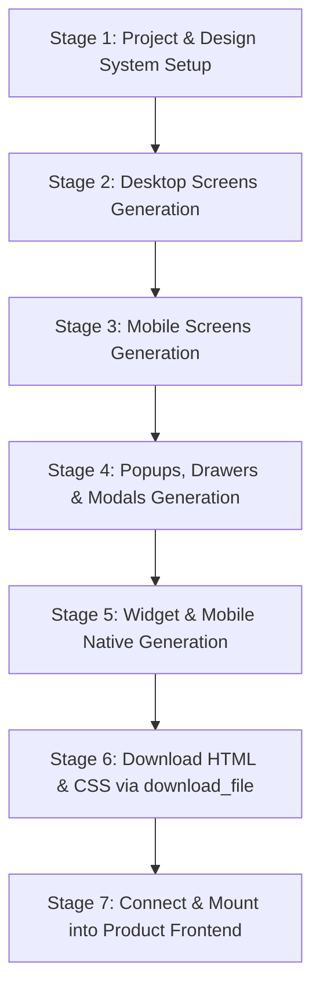

# Stitch MCP Integration & Execution Plan

Step-by-step roadmap for generating SupportPilot UI designs with Stitch MCP, downloading the resulting HTML/CSS assets, and connecting them to the React frontend.

---

## Execution Stages Overview

---

## Stage 1: Stitch Project & Design System Setup

1. **Create Project**:
   - Call `create_project` with title: `"SupportPilot Omnichannel Platform"`.
   - Store generated `projectId`.
2. **Upload Design System**:
   - Base64 encode `docs/ui-specs/DESIGN.md`.
   - Call `upload_design_md` with `projectId` and `designMdBase64`.
   - Call `create_design_system_from_design_md` or `create_design_system` to apply tokens (Inter font, Round 8, Indigo #4f46e5 primary).

---

## Stage 2: Desktop Screens Generation (`deviceType="DESKTOP"`)

Generate each core desktop screen using `generate_screen_from_text`:

1. `SCR-D01`: Login Screen (`LoginForm`)
2. `SCR-D02`: Register / Tenant Onboarding Screen (`RegisterForm`)
3. `SCR-D03`: Ticket Inbox Data Grid (`TicketInbox`)
4. `SCR-D04`: Ticket Detail & Thread View (`TicketDetail`)
5. `SCR-D05`: Live Chat & AI Copilot Console (`LiveChatView`)
6. `SCR-D06`: Knowledge Base & Vector Ingest Dashboard (`KnowledgeBaseView`)
7. `SCR-D07`: Customer Directory (`CustomersView`)
8. `SCR-D08`: Team & Workspace RBAC (`TeamView`)
9. `SCR-D09`: Automation Rules & SLA Editor (`AutomationView`)
10. `SCR-D10`: Analytics & Executive Dashboard (`AnalyticsDashboard`)
11. `SCR-D11`: Settings & API Keys / Webhooks (`SettingsView`)
12. `SCR-D12`: Help Center & FAQ Portal (`HelpCenterView`)

---

## Stage 3: Mobile Screens Generation (`deviceType="MOBILE"`)

Generate responsive mobile views for all screens:

1. `SCR-M01`: Mobile Login & Biometrics
2. `SCR-M02`: Mobile Ticket Inbox (Card view with pull-to-refresh)
3. `SCR-M03`: Mobile Ticket Detail & Reply Composer
4. `SCR-M04`: Mobile Live Chat View
5. `SCR-M05`: Mobile Knowledge Base & Test Search
6. `SCR-M06`: Mobile Customers Directory
7. `SCR-M07`: Mobile Team Workload
8. `SCR-M08`: Mobile Automation & SLA Matrix
9. `SCR-M09`: Mobile Analytics Overview
10. `SCR-M10`: Mobile Settings & Presence Toggle

---

## Stage 4: Popups, Modals & Slide-over Drawers

Generate isolated modal dialogs and slide-overs:

1. `POP-01`: Create Ticket Modal (`CreateTicketModal`)
2. `POP-02`: Chunk Vector Inspector Drawer (`KnowledgeBaseView`)
3. `POP-03`: Upload / Ingest Document Modal (`KnowledgeBaseView`)
4. `POP-04`: Create Automation Rule Modal (`AutomationView`)
5. `POP-05`: Add Customer Modal (`CustomersView`)
6. `POP-06`: Customer Profile Drawer (`CustomersView`)
7. `POP-07`: Invite Team Member Modal (`TeamView`)
8. `POP-08`: Generate API Key Modal (`SettingsView`)
9. `POP-09`: Add Webhook Modal (`SettingsView`)
10. `POP-10`: Notification Popover Menu (`NotificationBell`)

---

## Stage 5: Embeddable Customer Chat Widget

1. `WID-01`: Widget Floating Bubble Launcher (`WidgetBubble`)
2. `WID-02`: Widget Active Chat Window with AI Citations (`WidgetChat`)
3. `WID-03`: Widget Offline Fallback Form (`OfflineForm`)

---

## Stage 6: Asset Ingestion & Code Extraction

1. Call `list_screens` for `projectId`.
2. For each screen, retrieve `html_code.name` and call `download_file`.
3. Save downloaded HTML templates into `docs/ui-specs/generated-stitch-screens/<screen-name>.html`.
4. Extract Tailwind CSS classes, component structures, and SVG icons.

---

## Stage 7: Connect with Product Frontend

1. **Dashboard (`apps/web`)**:
   - Merge extracted Tailwind layouts and styles into `apps/web/src/components/*`.
   - Wire existing TanStack Query hooks (`useTickets`, `useAuthStore`, `api.*`) to the updated templates.
   - Maintain 100% test compatibility and test IDs (`data-testid`).
2. **Widget (`apps/widget`)**:
   - Update `WidgetBubble.tsx`, `WidgetChat.tsx`, `OfflineForm.tsx` with Stitch designs while keeping Socket.IO event hooks.
3. **Mobile (`apps/mobile`)**:
   - Adapt mobile layout structures into React Native / Expo components.
4. **Verification**:
   - Run `pnpm verify` (lint, type-check, tests) across all packages.
